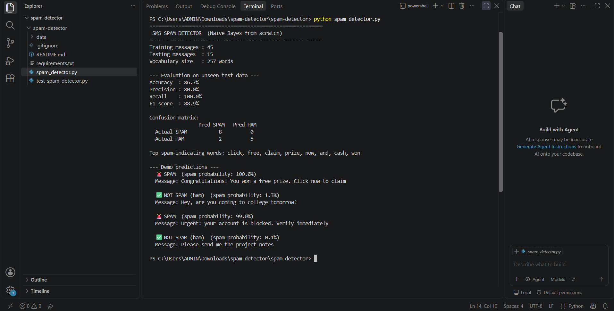

## Project Output

### Model Performance
- Accuracy: 86.7%
- Precision: 80%
- Recall: 100%
- F1 Score: 88.9%

### Execution Screenshot

## Ideas to extend
- Replace the dataset with the full UCI SMS Spam Collection
- Add a Flask/Streamlit web UI
- Compare with scikit-learn's `MultinomialNB`
